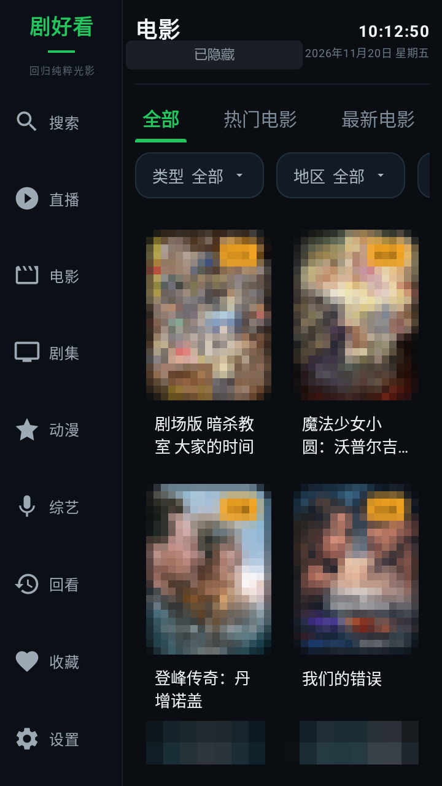
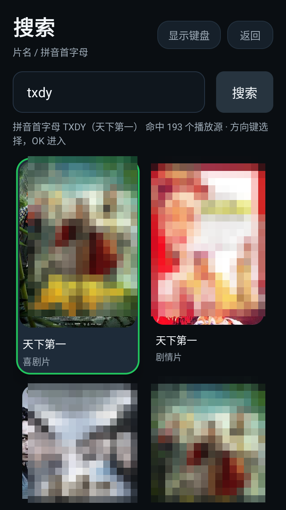
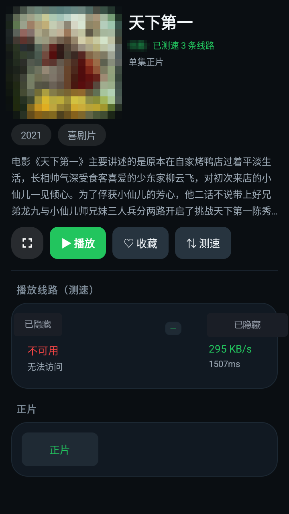
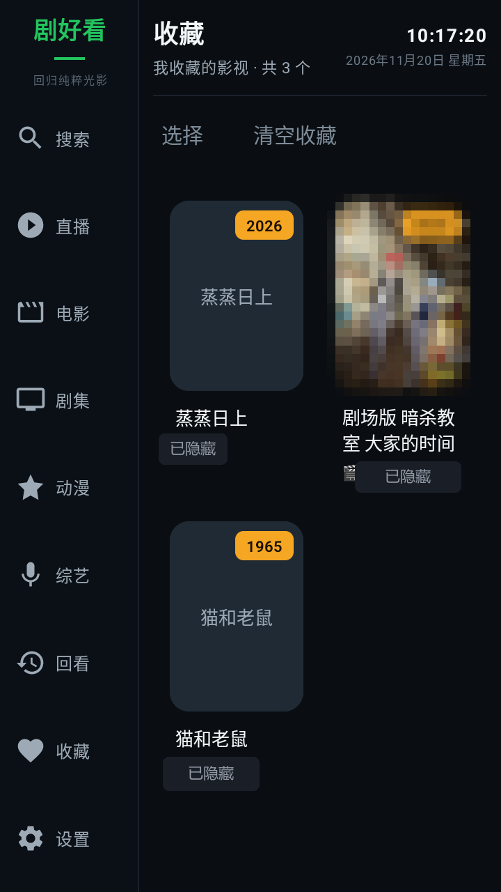
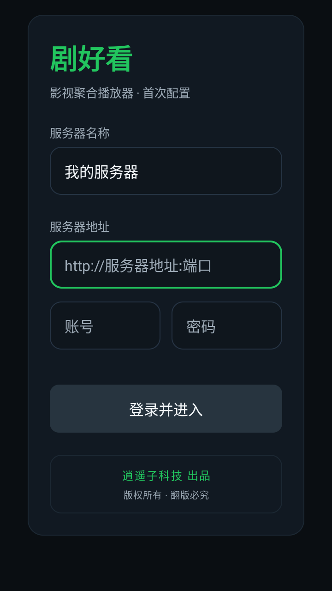
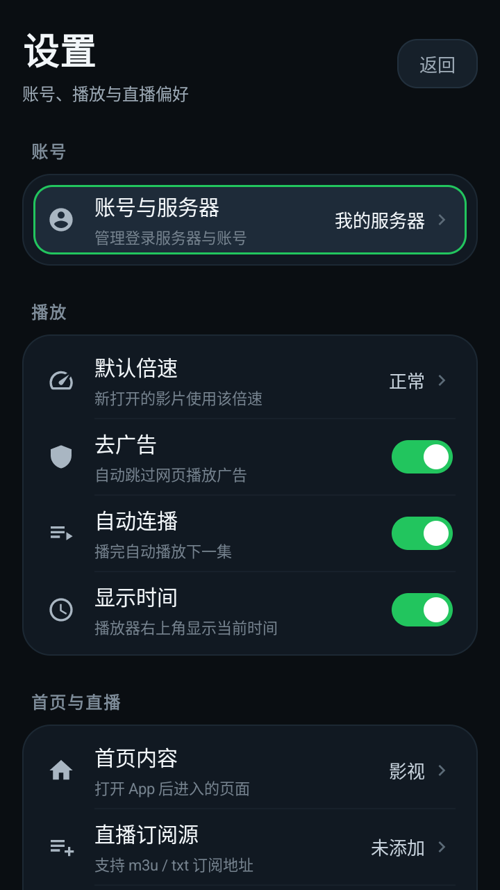
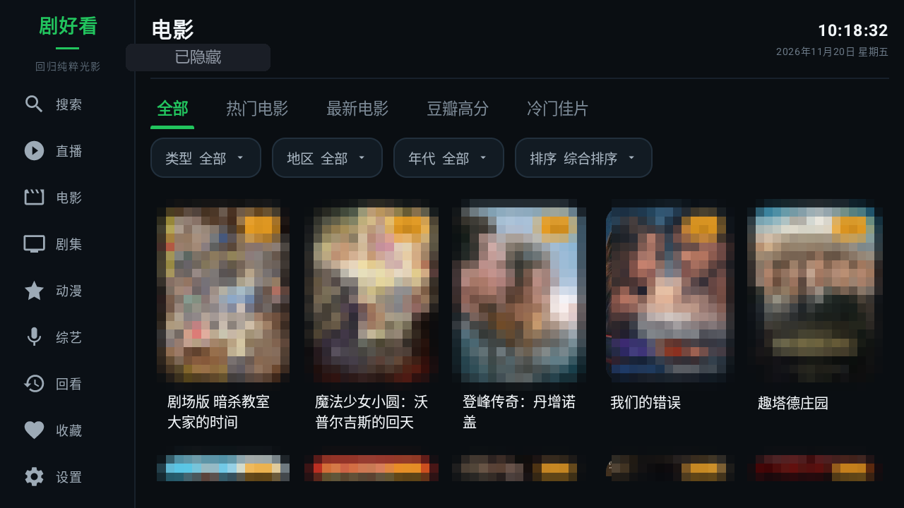
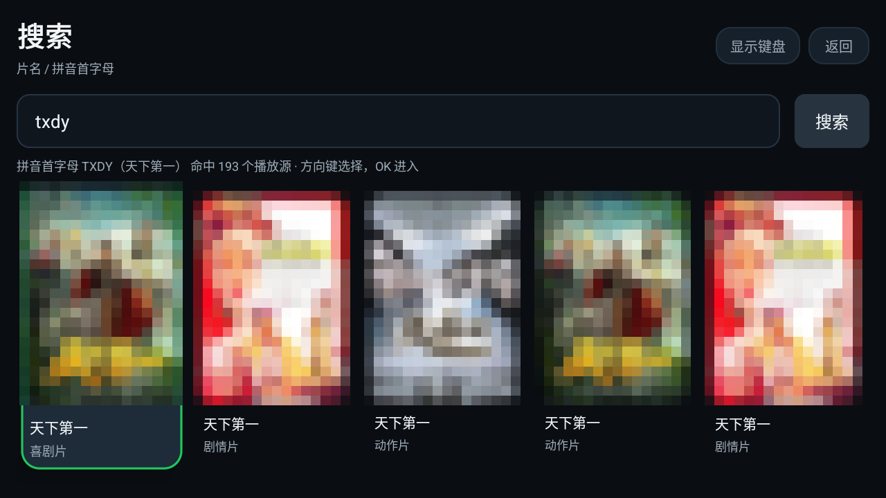

# 剧好看 · Juhaokan


Android TV / 手机 / 平板通用的影视聚合客户端，原生 Java 编写，界面与遥控器操作全部自绘。

> 本项目只是**客户端**，不包含任何影视资源、直播源或服务器地址。使用前需要自行部署一套与
> LibreTV / MoonTV 兼容的服务端，并在登录页填写地址与账号。



## 功能

- **影视浏览**：电影 / 剧集 / 动漫 / 综艺分类、筛选、豆瓣推荐、每日放送
- **搜索**：片名搜索 + 拼音首字母搜索（如 `xyj` → 西游记），内置词库兜底，无结果提示友好
- **详情与播放**：多源切换、选集、自动记忆播放进度、跳过片头片尾、去广告、0.1–8 倍速
- **直播**：支持 m3u / txt 订阅源，同名频道合并、起播失败自动换源、手动切换线路
- **收藏与同步**：收藏、播放记录、跳过配置与服务端同步，支持批量取消收藏
- **多服务器**：可保存多个服务端地址，随时切换默认账号
- **投屏**：DLNA 搜索同一局域网设备，影视与直播均可投屏
- **全端适配**：手机竖屏 2 列、手机横屏 / 电视 / 平板自适应列数；遥控器方向键 + OK、鼠标、触屏均可操作

## 截图

| 手机 · 首页 | 手机 · 搜索（拼音首字母） | 手机 · 详情与测速 |
| --- | --- | --- |
|  |  |  |

| 手机 · 收藏与同步 | 手机 · 登录 | 手机 · 设置 |
| --- | --- | --- |
|  |  |  |

| 电视 · 横屏首页 | 电视 · 横屏搜索 |
| --- | --- |
|  |  |

> 截图中的海报与平台名称已做遮挡处理。

## 技术栈

- 语言：Java 8（无 Kotlin、无第三方 UI 框架）
- 播放内核：AndroidX Media3 / ExoPlayer 1.4.1（HLS、缓存、DataSource 拦截）
- 网络：OkHttp 3.14.9
- 最低版本：Android 6.0（API 23），targetSdk 34

## 目录结构

```
app/src/main/
├── java/com/oriontv/plus/
│   ├── MainActivity.java      首页、分类浏览、左栏导航
│   ├── SearchActivity.java    搜索页（26 键键盘 / 拼音首字母）
│   ├── DetailActivity.java    详情、多源、选集
│   ├── PlayerActivity.java    播放器（倍速、跳过、投屏、去广告）
│   ├── LiveActivity.java      直播（订阅源、频道合并、换源）
│   ├── SettingsActivity.java  设置、账号与服务器
│   ├── ServersActivity.java   多服务器管理
│   ├── Api.java               服务端接口封装
│   ├── CastManager.java       DLNA 投屏
│   └── player/                播放器扩展（去广告数据源、进度条）
├── assets/title_dict.txt      拼音首字母搜索的片名词库
└── res/                       布局、主题、图标
```

## 编译

环境要求：JDK 17、Android SDK Platform 34。

```bash
# macOS / Linux
./gradlew assembleRelease

# Windows
gradlew.bat assembleRelease
```

产物：`app/build/outputs/apk/release/app-release.apk`

> 仓库未附带签名证书，release 默认使用 debug 签名，方便直接安装体验。正式发布请替换为自己的
> keystore，并在 `app/build.gradle` 中配置 `signingConfigs`。

## 服务端

客户端所有数据都来自你自己部署的服务端，登录页填写 `http://服务器地址:端口` 与账号密码即可。
接口契约见 [docs/API.md](docs/API.md)，与 LibreTV / MoonTV 的服务端接口保持一致。

## 自定义

`app/build.gradle` 的 `defaultConfig` 中预留了几个开关，方便二次开发：

| 字段 | 说明 |
| --- | --- |
| `BUILT_IN_SERVER` | 是否内置服务器（默认关闭，登录页手动填写） |
| `SERVER_URL` / `SERVER_USER` / `SERVER_PASS` | 内置服务器地址与账号，默认空 |
| `LIVE_SOURCES` | 预置直播订阅源，格式 `名称\|地址`，分号分隔，默认空 |
| `SHOW_BRAND` | 是否在登录页 / 设置页显示品牌条，默认关闭 |

> 请勿把真实服务器地址、账号密码提交到公开仓库。

## 赞助

如果这个项目帮到了你，可以扫码请作者喝杯咖啡。赞助完全自愿，不影响任何功能与后续更新。

<table>
  <tr>
    <td align="center"><br>微信</td>
    <td align="center"><br>支付宝</td>
  </tr>
</table>

## 免责声明

本项目仅供学习 Android 开发与流媒体技术交流使用，不提供、不存储、不分发任何影视内容。
软件本身不含任何资源，所有内容均来自用户自行配置的第三方服务端，与本项目作者无关。
请遵守当地法律法规，不得将本项目用于任何商业或侵权用途。

## License

[MIT](LICENSE)
